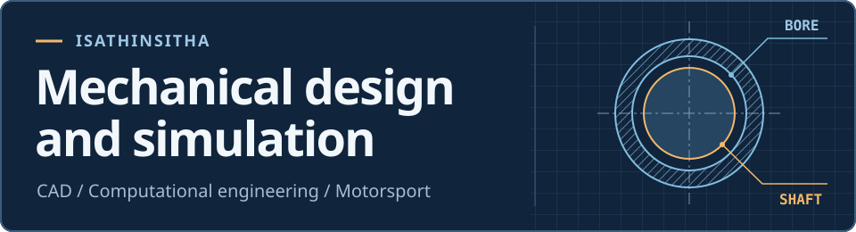

I'm interested in mechanical engineering, especially how tolerances, loads, and operating conditions change the way a design behaves. I work in SOLIDWORKS and use Python to model problems I can check with calculations or test cases. Vehicle engineering and Formula 1 are where I look for many of those problems.

## Design and analysis

### [StackOpt](https://github.com/isathinsitha/stackopt)

A Python tool for checking worst-case clearance and choosing among specified drawing tolerances. It reads bound dimensions from SOLIDWORKS or FreeCAD and saves the inputs for offline replay.

In the synthetic bore-and-shaft example, tightening just the bore tolerance from **±25 µm to ±15 µm** recovers **10.0092 µm of upper clearance margin**. The next check is to use it on a representative assembly with a real drawing decision. [Worked example](https://github.com/isathinsitha/stackopt/tree/main/examples/acceptance-v1) · [Solver architecture](https://github.com/isathinsitha/stackopt/blob/main/ARCHITECTURE.md)

## Rover engineering

### [Periapsis · NASA Space Apps](https://github.com/AbhimanthaW/Periapsis)

A team project on planning Mars rover traverses. My contributions include regional cell ranking and terrain-risk screening. I also developed run reports to capture the evidence behind planning results. [Cell ranking](https://github.com/AbhimanthaW/Periapsis/pull/18) · [Terrain screening](https://github.com/AbhimanthaW/Periapsis/pull/24) · [Run reporting](https://github.com/AbhimanthaW/Periapsis/pull/36)

I'm also working on a separate [rover CAD and simulation project](https://github.com/isathinsitha/RoverSimulation) focused on terrain traversal.

## Motorsport data

### [Apex Pulse](https://github.com/isathinsitha/Apex-Pulse-F1-viewer)

An OpenF1 dashboard for replaying driver positions and comparing historical lap and telemetry data.
